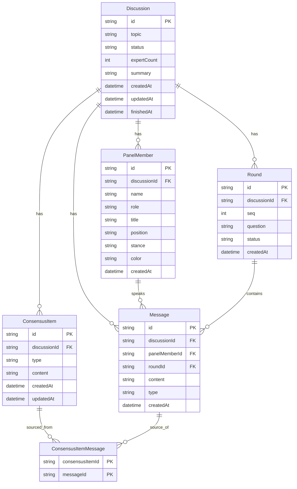

# 数据模型与 ER 图

## ER 图

## 实体说明

### Discussion（讨论）
核心实体，代表一场完整的圆桌讨论。

| 字段 | 类型 | 说明 |
|------|------|------|
| id | String | UUID 主键 |
| topic | String | 讨论话题 |
| status | String | 状态：waiting / generating / ongoing / finished |
| expertCount | Int | 专家人数（不含主持人） |
| summary | String? | 最终总结（讨论结束后生成） |
| createdAt | DateTime | 创建时间 |
| updatedAt | DateTime | 更新时间 |
| finishedAt | DateTime? | 结束时间 |

### Round（轮次）
讨论中的一轮：主持人抛出子问题 → 一批专家发言 → 收尾。轮次是共识提炼的边界，也是主持人追问的上下文锚点。

| 字段 | 类型 | 说明 |
|------|------|------|
| id | String | UUID 主键 |
| discussionId | String | 关联讨论 ID |
| seq | Int | 轮次序号（从 1 起，同讨论内唯一） |
| question | String? | 主持人本轮抛出的子问题/串场语 |
| status | String | 状态：open / closed |
| createdAt | DateTime | 创建时间 |

### PanelMember（嘉宾）
参与讨论的角色，包括主持人和专家。

> 注：PanelMember 不持久化"运行时发言状态"（idle / preparing / speaking）。该状态仅存在于后端内存，并通过 SSE `status_update` 事件实时推送；任何"谁讲过话、讲了几次"的持久信息由 Message 表推导。

| 字段 | 类型 | 说明 |
|------|------|------|
| id | String | UUID 主键 |
| discussionId | String | 关联讨论 ID |
| name | String | 姓名 |
| role | String | 角色：host / expert |
| title | String | 头衔（如：主持人、资深经济学家） |
| position | String | 职位/机构 |
| stance | String | 立场描述 |
| color | String | 专属颜色（十六进制，如 #8B5CF6） |
| createdAt | DateTime | 创建时间 |

### Message（发言）
讨论过程中的每一条发言记录。

| 字段 | 类型 | 说明 |
|------|------|------|
| id | String | UUID 主键 |
| discussionId | String | 关联讨论 ID |
| panelMemberId | String | 发言人 ID |
| roundId | String? | 所属轮次 ID（开场前可空） |
| content | String | 发言内容 |
| type | String | 类型：speech / internal / summary |
| createdAt | DateTime | 发言时间 |

### ConsensusItem（共识与分歧）
从讨论中提炼的共识或分歧点。

| 字段 | 类型 | 说明 |
|------|------|------|
| id | String | UUID 主键 |
| discussionId | String | 关联讨论 ID |
| type | String | 类型：consensus / divergence |
| content | String | 内容描述 |
| createdAt | DateTime | 创建时间 |
| updatedAt | DateTime | 更新时间 |

### ConsensusItemMessage（共识来源发言）
多对多关联表：一条共识可追溯多条来源发言，一条发言可被多条共识引用。用于反幻觉溯源（验证共识确由讨论内容提炼而来）。

| 字段 | 类型 | 说明 |
|------|------|------|
| consensusItemId | String | 共识项 ID（复合主键） |
| messageId | String | 来源发言 ID（复合主键） |
